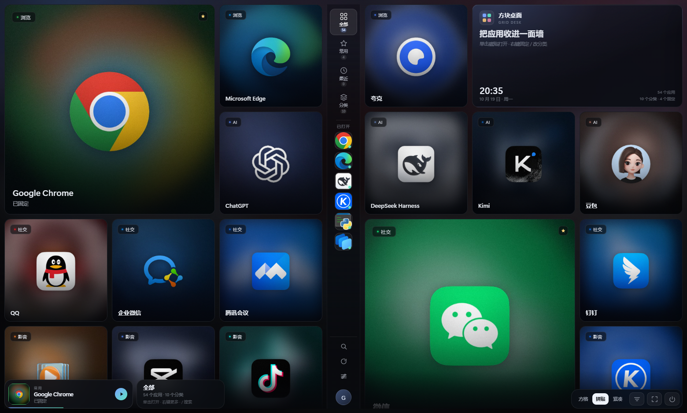
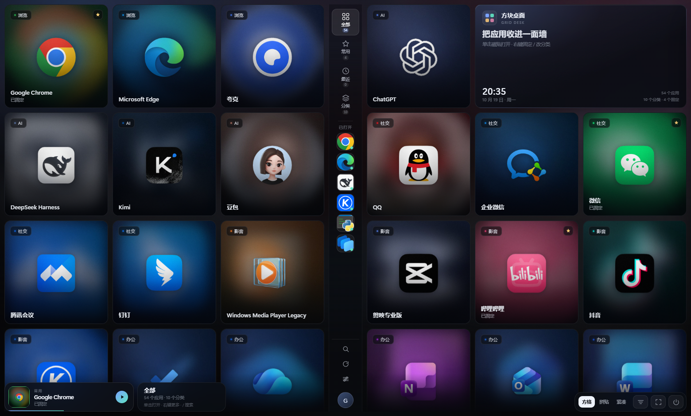
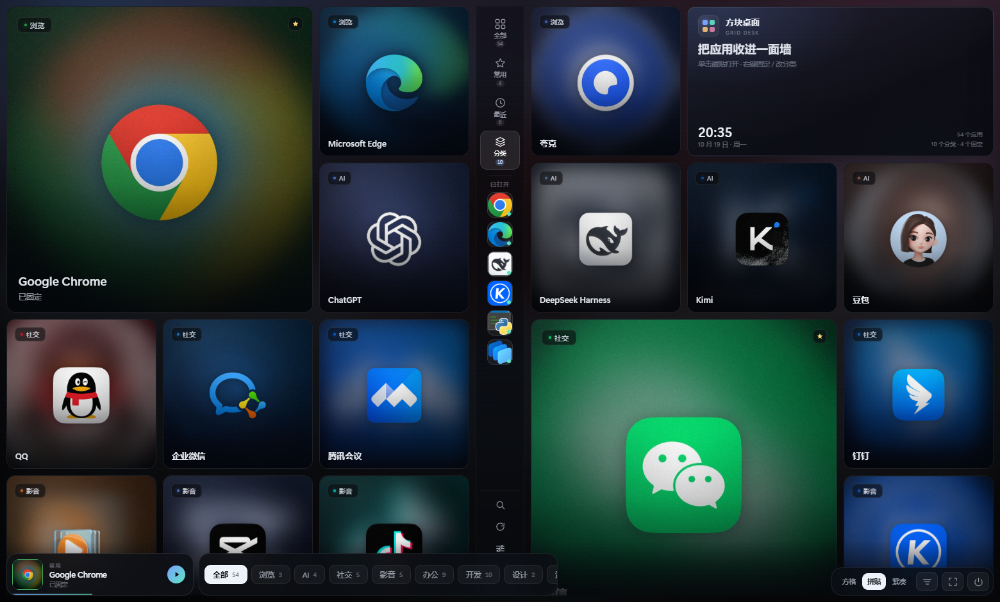
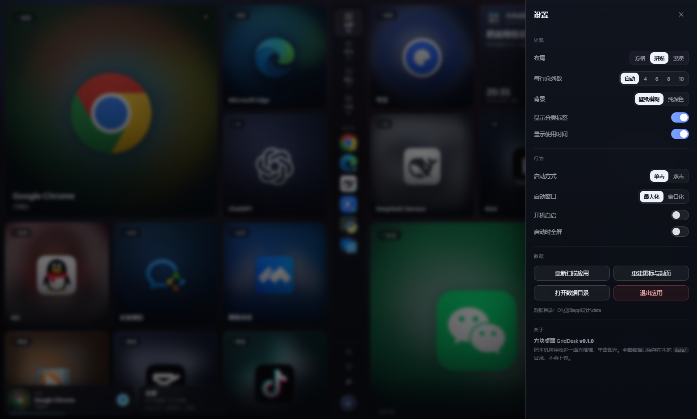
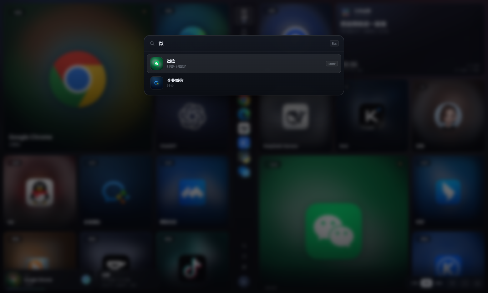
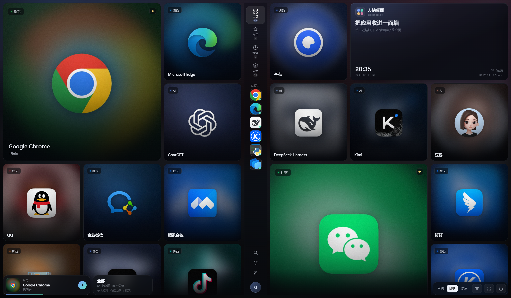

# 方块桌面 · GridDesk

> 深色玻璃的「应用墙」桌面：整个窗口铺满应用磁贴，中间一条细窄竖栏放导航和已打开应用，
> 底部是「最近打开」播放条式卡片，右上角是「把应用收进一面墙」卡片，单击磁贴即开。

参考视觉灵感来自常见的音乐 App 封面墙（深色玻璃、封面磁贴、分类角标、底部播放条），
把它迁移到「桌面应用启动器」的场景：每个应用是一块 1:1 的方形磁贴，
磁贴里是应用图标与它自己的品牌色封面，可以固定、分类、拖拽排序、搜索、全屏。



## 快速开始

1. 双击 **`启动方块桌面.vbs`**（不会弹黑色控制台窗口），应用窗口会以**最大化**打开（设置里可改成窗口化）。
2. 第一次启动会扫描开始菜单 / 桌面 / Microsoft Store 应用，并现场生成图标与封面，
   大约 10–30 秒；之后再启动是秒开（有缓存）。
3. 想放到桌面：双击 **`创建桌面快捷方式.vbs`**，桌面会出现「方块桌面」图标。
4. 点底栏「退出」会关闭窗口并结束本地服务；直接关闭窗口，服务也会在 2 秒后自动退出。

调试时用 **`启动方块桌面(调试).bat`**，能看到服务日志。

## 已实现的功能

| 能力 | 说明 |
| --- | --- |
| 应用扫描 | 开始菜单（用户 + 公共）、桌面快捷方式、UWP / Store 应用，自动去重、过滤卸载/帮助/更新等无用项 |
| 图标提取 | Shell 256px 图标 + UWP 包内高清 logo；识别并跳过 Windows「白纸」通用图标；失败时生成字母磁贴 |
| 封面生成 | 从图标提取品牌主色，生成「渐变 + 模糊环境层 + 清晰图标 + 高光 / 暗角 / 噪点」的方形封面 |
| 三种布局 | 方格（统一 1:1）/ 拼贴（固定应用放大 2×2，接近参考图）/ 紧凑（小磁贴多列） |
| 整窗覆盖 | 没有顶栏/底栏，应用磁贴铺满整个窗口；中间只留一条 76px 的细窄竖栏 |
| 中间竖栏 | 上：全部 / 常用 / 最近 / 分类导航；中：「已打开」应用图标（绿点 = 运行中）；下：搜索 / 刷新 / 设置 / 头像 |
| 底部浮层 | 左下：「最近打开」播放条式卡片 + 视图信息（分类视图变成筛选条）；右下：布局 / 排序 / 全屏 / 退出 |
| 磁贴节奏 | 间隙 10px（紧凑 8px），圆角 14px，窗口缩放时每侧列数与尺寸自适应 |
| 启动应用 | 单击启动（可切换双击）；快捷方式失效时自动在同盘常见目录里找回 exe |
| 组织 | 固定到常用、重命名、改分类、隐藏、拖拽排序、按名称 / 最近 / 常用排序 |
| 搜索 | `/` 呼出，支持名称 / 分类 / 路径匹配，↑↓ 选择、Enter 打开 |
| 键盘 | ↑↓←→ 移动焦点、Enter 打开、P 固定、`/` 搜索、Esc 关闭浮层 |
| 设置 | 布局、列数、背景、标签/时间显示、启动方式、启动窗口（最大化 / 窗口化）、开机自启、全屏、重新扫描、重建素材 |
| 其他 | 壁纸模糊背景、跟随应用的品牌色封面、启动动效、右键菜单、Toast 提示、隐藏可撤销 |

## 目录结构

```
桌面app设计/
├─ 启动方块桌面.vbs           # 无窗口启动 + 打开应用窗口
├─ 启动方块桌面(调试).bat     # 带日志的调试启动
├─ 创建桌面快捷方式.vbs       # 在桌面生成快捷方式
├─ 停止方块桌面.bat           # 兜底停止本地服务
├─ server.py                  # 本地 Flask 服务 + 窗口生命周期
├─ build_portable.py          # 打包成免安装便携版（PyInstaller + zip）
├─ dist/                      # 打包产物（便携版目录 + zip，可删除后重新生成）
├─ core/
│  ├─ apps_scan.py            # 应用扫描 / 过滤 / 分类 / 失效快捷方式修复
│  ├─ icons.py                # 256px 图标提取、主色、封面生成、壁纸处理
│  ├─ store.py                # 设置、应用元数据、扫描缓存
│  └─ wallpaper.py            # 壁纸读取与模糊背景
├─ web/                       # 前端（原生 HTML/CSS/JS，无构建）
│  ├─ index.html
│  ├─ app.css
│  └─ app.js
├─ data/                      # 运行时数据（缓存、设置、日志，可安全删除后重建）
├─ assets/app.ico             # 应用图标
├─ preview/                   # 界面截图
├─ 使用说明.md                # 使用手册
└─ 设计说明.md                # 设计规范 + 技术方案 + 路线图
```

## 环境要求

- Windows 10 / 11
- Python 3.9+（本机为 Anaconda Python 3.12），需要 `flask`、`pillow`、`numpy`、`pywin32`
- Chrome 或 Edge（用于无浏览器界面的应用窗口）

依赖已随本机 Anaconda 安装；如换机器，`pip install flask pillow numpy pywin32` 即可。

## 打包成免安装便携版

项目里带了打包脚本，会把服务、前端资源、预生成的图标/封面缓存和启动脚本一起打成
**免安装便携版**。打包脚本可以同时产出三种形态：

```powershell
python build_portable.py                # 三种都打
python build_portable.py --runtime-only # 只打「完整版」
```

| 产物 | 体积 | 需要 Python | 安全提示 |
| --- | --- | --- | --- |
| `dist/方块桌面-完整版-<版本>.zip` | 约 37 MB | 不需要（自带 Python 运行时） | **无**（不含未签名 exe） |
| `dist/方块桌面-脚本版-<版本>.zip` | 约 4 MB | 需要本机已装 Python | 无 |
| `dist/方块桌面-便携版-<版本>.zip` | 约 35 MB | 不需要 | 未签名 exe，可能弹 SmartScreen / 杀软误报 |

### 为什么「完整版」能避免安全提示？

- 包里**没有自编译的 exe**，启动入口是 `.vbs`，真正运行的是
  `runtime\pythonw.exe`——**Python Software Foundation 官方签名**的 Python 3.12 运行时；
- Python 运行时来自 python.org 的 embeddable 包，依赖库（flask / pillow / numpy / pywin32 / psutil）
  已装进 `runtime\site-packages`；
- 因此不会触发「未知发布者 / SmartScreen 有危害」的拦截，也不挑用户电脑是否装过 Python。

> 想让**exe 版**也彻底无提示，唯一的正规办法是给 exe 买一张代码签名证书
> （OV/EV，需企业或个人实名验证，约 $100–400/年）并用 `signtool` 签名；
> 否则任何未签名的自编译 exe 在新电脑上都会被 SmartScreen 先拦一次。

### 使用与分发

- 解压到可写目录（桌面、D 盘都行），双击 **启动方块桌面.vbs** 启动；
- 若系统提示「此文件来自其他计算机」，先右键 zip →「属性」→ 勾选「解除锁定」→ 再解压；
- 需要目标机器装有 **Chrome 或 Edge**（用来承载无边框应用窗口）；
- 数据默认保存在程序目录 `data/`，目录不可写时自动改用 `%LOCALAPPDATA%\GridDesk\data`。

## 截图

| 方格布局 | 分类浏览 |
| --- | --- |
|  |  |

| 设置抽屉 | 搜索 |
| --- | --- |
|  |  |

最大化打开时的完整界面（真实应用窗口截图）：



