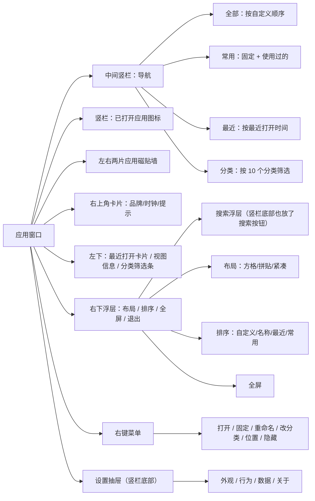
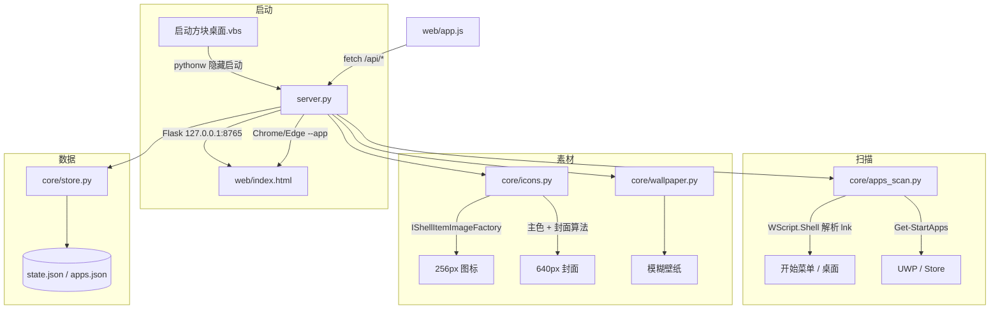
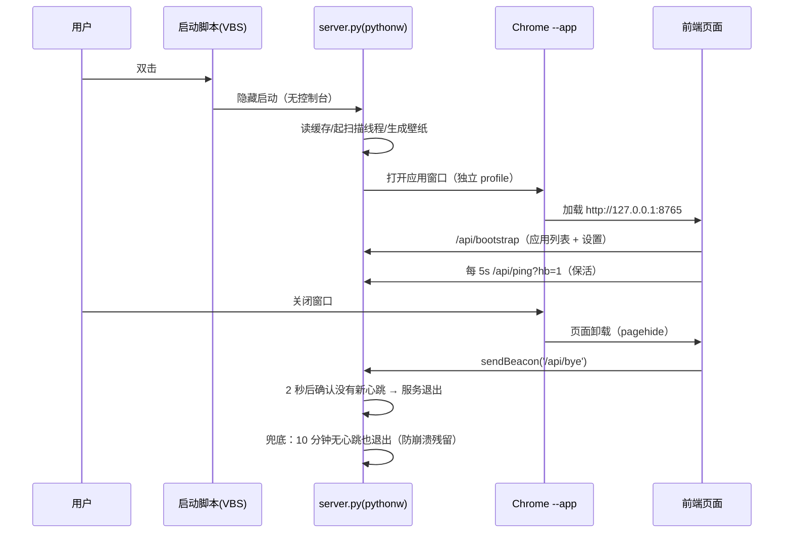

# 方块桌面 · 设计说明

> 版本 v0.1.1 · 2026-10 · 本地可运行原型

---

## 1. 项目定位

**一句话**：把 Windows 上零散的应用图标，重新组织成一面「深色玻璃 + 封面磁贴」的方格墙，
让「找应用」变成「看一面墙」。

目标用户是同时装着几十个桌面应用、开始菜单已经翻不动的人。核心诉求有三点：

1. **好看**：桌面工具也应该有审美，参考图给出的「封面墙」气质可以迁移到应用启动器；
2. **顺手**：点「打开」即启动、搜索直达、常用置顶，不改变原有的使用习惯；
3. **零负担**：不装驱动、不写注册表、不联网，一个文件夹拷走就能用。

非目标（本版不做）：实时窗口缩略图、替换系统桌面、多屏管理、应用分组文件夹。

---

## 2. 从参考图拆解出的设计语言

用户提供的参考图是一张音乐 App 的「封面墙」页面：深色半透明窗口里铺满方形封面，
每张封面上有分类角标（歌单）、标题、副标题，左侧有一条竖向导航，底部是播放条。
它之所以好看，关键不在内容，而在几条可迁移的规则：

| 参考图特征 | 迁移到启动器的做法 |
| --- | --- |
| 深色、低对比、毛玻璃面板 | 深色玻璃背景 + 1px 半透明描边 + 轻微内发光 |
| 方形封面铺满整个视口，信息藏在封面里 | 1:1 方形磁贴，信息压在封面底部的渐变压暗层上 |
| 封面本身带品牌色 | 用应用图标的主色生成「专属封面」，每个应用一种颜色气质 |
| 左上角小角标（歌单） | 左上角分类角标（浏览 / 社交 / 影音…） |
| 局部大卡片（2×2 拼贴） | 拼贴布局下固定应用放大成 2×2 |
| 底部播放条 | 左下角「最近打开」卡片：封面 + 最近应用 + 播放键 + 细进度线；右下角放布局/排序/全屏/退出 |
| 细窄竖向导航 | 中间竖栏（76px，无圆角、半透明窄条）：导航 + 已打开应用图标 + 工具 |
| 左侧的大封面 | 右上角卡片：品牌、大号时钟、应用统计和「把应用收进一面墙」的提示 |
| 整窗铺满封面 | 去掉顶栏/底栏，磁贴墙铺满整个窗口，左右两片把中间竖栏围在中间（「app 包围中间那栏」） |

> 结论：不复制参考图的内容，只继承它的**版式节奏与材质**，让用户一眼觉得「是那个感觉」，
> 但信息结构完全服务于「启动应用」。

---

## 3. 设计原则

1. **内容优先，界面退后**：磁贴封面铺满整个窗口；导航和已打开应用收成中间一条细窄竖栏，工具收在竖栏底部、其他控件浮在窗口四角，用低对比色。
2. **一屏即答案**：打开就是全部应用，不需要先选分类；搜索是加速器而不是必经路径。
3. **可预期的反馈**：悬停浮起、按下回弹、启动闪光、打开 Toast——每个动作都有回响。
4. **克制的动效**：只做位移 / 透明度 / 缩放三类动画，时长 180–550ms，尊重 `prefers-reduced-motion`。
5. **个性化但不复杂**：用户能改的只有「布局、顺序、固定、分类、名字」，其余自动完成。

---

## 4. 视觉规范

### 4.1 色彩

| Token | 值 | 用途 |
| --- | --- | --- |
| `--bg` | `#06070a` | 兜底背景 |
| 背景层 | 壁纸模糊（亮度约 54%、高斯模糊 30px）+ 冷色渐变 + 三个 80px 模糊光斑 + 噪点 | 氛围 |
| `--text` | `#eef2fa` | 主文字 |
| `--text-2` | `rgba(226,233,245,.62)` | 次级文字 / 图标 |
| `--text-3` | `rgba(220,229,244,.36)` | 提示文字 |
| `--line` | `rgba(255,255,255,.075)` | 分隔线 / 描边 |
| `--glass` | `rgba(255,255,255,.045)` | 玻璃面板底色 |
| `--accent` | 每个应用自己的品牌主色 | 磁贴辉光、角标小圆点、选中态 |
| UI 强调色 | `#7aa2ff → #5fe3c1` 渐变 | 进度条、开关、选中导航条 |

每个应用的主色由图标计算：按色相分 24 桶加权（饱和度和中间明度权重更高），
取最「显眼」的色相求均值，再归一化到适合深色底的饱和度 ≥ 0.42、明度 0.54–0.76。

### 4.2 字体与字号

系统字体栈：`Segoe UI Variable Display / Segoe UI / Microsoft YaHei UI`。

| 层级 | 字号 | 字重 | 用途 |
| --- | --- | --- | --- |
| 磁贴标题 | 13px / 19px（2×2） | 600 | 应用名 |
| 磁贴副标题 | 10px / 12px | 400 | 上次打开时间 |
| 分类角标 | 10px | 400 | 分类名 |
| 导航文字 | 9.5px | 400 | 全部 / 常用 / 最近 / 分类 |
| 竖栏小标签 | 8.5px | 400 | 「已打开」、导航计数 |
| 最近打开卡 | 12.5px / 9.5px | 600 / 400 | 应用名 / 上次使用 |
| 视图信息卡 | 12.5px / 10px / 9px | 400 | 当前视图 / 数量 / 快捷键 |
| 右上卡片标题 | 18px | 600 | 「把应用收进一面墙」 |
| 时钟 | 21px | 600 | 右上角卡片里的时间 |

### 4.3 形状与间距

- 磁贴圆角 14px（紧凑 10px），面板 14–16px，按钮 9–12px，开关 999px。
- 整窗磁贴墙：中间竖栏 76px（`--dock-w`，窄屏 68px），左右两片磁贴墙各占剩余宽度的一半，网格中间留出竖栏列；窗口只留 10px 外边距。
- 网格间距 10px（紧凑 8px）；底部浮层高 66px，给磁贴墙留 86px 下边距，保证最后一行能滚出来。
- 窗口宽度小于 1140px 时右上角卡片隐藏（不再占格子）；小于 1280px 时视图信息卡隐藏；磁贴列数随窗口宽度自动重排。
- 磁贴统一 1:1；2×2 固定磁贴高度 = 2 行 + 间距，保持严格正方形。
- 所有描边 1px，颜色为白色 7%–16% 透明度；悬停时提升到 22% 并叠加品牌色辉光。

### 4.4 材质

- 玻璃面板：`backdrop-filter: blur(28px) saturate(150%)` + 顶部 1px 高光内阴影。
- 磁贴：封面图 + 底部 74% 黑色渐变压暗（保证文字可读）+ 顶部 24% 渐变压暗 + 顶部内高光。
- 全局噪点层（feTurbulence，5% 不透明度，soft-light）消除大面积渐变的色带。

### 4.5 动效

| 动效 | 时长 / 曲线 | 说明 |
| --- | --- | --- |
| 磁贴入场 | 550ms `cubic-bezier(.22,.8,.24,1)`，按索引 18ms 递增 | 首次渲染错峰浮现 |
| 悬停浮起 | 380ms | 上移 4px + 辉光 + 封面放大 5.5% |
| 启动反馈 | 850ms | 磁贴压缩回弹 + 品牌色径向闪光 |
| 搜索 / 菜单 / 抽屉 | 160–420ms | 位移 + 淡入，抽屉 42ms 缓动 |
| 背景光斑 | 26–38s 循环 | 极缓慢漂移，避免静态感 |

---

## 5. 布局系统

整体是**整窗包围式布局**：应用磁贴墙铺满整个窗口，中间只留一条 76px 的细窄竖栏，
左右两片墙把竖栏围在中间；右上角卡片占据右侧墙最上面两个格子（紧凑布局下占两行），
左下角是「最近打开」播放条式卡片，右下角是布局/排序/全屏/退出浮层。
左右墙内部再提供三种排布，它们共用同一套数据，只是渲染参数不同：

| 布局 | 每侧列数 | 磁贴 | 特点 |
| --- | --- | --- | --- |
| 拼贴（默认） | 自动，每侧 3–4 列 | 固定应用 2×2，其余 1×1 | 最接近参考图，有大小节奏 |
| 方格 | 自动，每侧 3–4 列 | 统一 1:1 | 最整齐，符合「每个应用一个方格」的诉求 |
| 紧凑 | 自动，每侧 5 列左右 | 小磁贴、隐藏副标题和分类角标 | 一屏看更多应用 |

实现要点：

- 网格模板是 `repeat(var(--c), 1fr) var(--dock-w) repeat(var(--c), 1fr)`：左右各 `c` 列，中间一列留给竖栏；
- JS 用 `clientWidth` 计算 `tile = (宽 - 竖栏宽 - 2c*间距) / 2c`，保证每格是正方形；
- 每个磁贴用绝对坐标（`grid-column` + `grid-row`）显式排布：一个小型排布器按顺序扫描左右两片，
  跳过中间竖栏列和右上角卡片占用的格子，固定应用（拼贴布局）占 2×2 块；
- 窗口缩放时 `ResizeObserver / resize` 重算，磁贴尺寸连续变化；
- 用户可手动指定 4–10 列（左右合计；紧凑布局始终自动）。

---

## 6. 磁贴设计

### 6.1 结构

```
┌───────────────────────────────┐
│ ● 浏览            ★            │  ← 分类角标（左） / 固定星标（右）
│                               │
│            [图标]              │  ← 封面：品牌色渐变 + 模糊环境层 + 清晰图标
│                               │
│  Google Chrome                │  ← 名称（底部渐变压暗层上）
│  上次 3 天前                    │  ← 副标题（用过的应用才显示）
│                     [打开 ↗]   │  ← 悬停时出现
└───────────────────────────────┘
```

### 6.2 状态

| 状态 | 表现 |
| --- | --- |
| 默认 | 1px 白色 8% 描边，封面铺满，文字压在渐变上 |
| 悬停 | 上移 4px、描边提亮、品牌色辉光、封面放大、显示「打开」、隐藏副标题（避免与按钮重叠） |
| 键盘焦点 | 2px 品牌色描边 + 深色外圈，`scrollIntoView({block:'nearest'})` |
| 固定 | 右上角金星标；拼贴布局下 2×2 |
| 启动中 | 压缩回弹 + 品牌色径向闪光，Toast「已打开 XX」 |
| 拖拽 | 被拖磁贴半透明缩小，目标磁贴显示虚线框 |

### 6.3 封面生成算法（服务端 Pillow + NumPy）

1. 提取 256px 图标（Shell 接口，UWP 从包内 `AppxManifest.xml` 找 logo）；
2. 裁掉透明边、居中补方；
3. 从图标像素统计品牌主色，归一化成适合深色底的强调色；
4. 以强调色生成对角渐变底（主色压暗 72% → 旋转色相压暗 62%）；
5. 叠加「图标放大 110% + 高斯模糊 8%」的环境层（40% 不透明度），形成封面里的「画面感」；
6. 叠加中部径向提亮 + 左上角光晕；
7. 贴上清晰图标（38% 边长）+ 柔和投影；
8. 顶部高光、边缘暗角、细颗粒噪点，输出 640×640 JPEG（约 40–70KB）。

> 这样每个磁贴都有「专辑封面」的层次，而不是一个图标贴纯色块；
> 相同图标的主色一致，整面墙有统一的色彩逻辑。

### 6.4 图标兜底

- 图标抓取失败或拿到 Windows 通用「白纸」图标时：用感知哈希对比内置的通用图标模板，判定后丢弃；
- 仍然拿不到时生成**字母磁贴**：品牌色渐变圆角方块 + 首字（中文取首字，英文取首字母）；
- UWP 应用优先读取 `AppxManifest.xml` 里 `Square44x44Logo / Square150x150Logo` 的最高分辨率变体。

---

## 7. 信息架构与导航



**默认视图就是全部应用**，不做启动页、不做广告位；分类和搜索都是可选的加速路径。

---

## 8. 交互设计

### 8.1 核心操作

| 操作 | 触发 | 反馈 |
| --- | --- | --- |
| 打开应用 | 点磁贴右下角「打开」按钮 | 启动闪光 + Toast |
| 固定 / 取消 | 右键菜单 / 选中后 P | 星标出现，常用计数 +1，Toast |
| 重命名 | 右键 → 重命名 | 输入框（prompt），只改显示名 |
| 改分类 | 右键 → 修改分类 → 选择 | 角标立即变化 |
| 隐藏 | 右键 → 隐藏 | 磁贴消失，Toast 带「撤销」 |
| 打开位置 | 右键 → 打开文件位置 | 资源管理器定位到快捷方式 |
| 拖拽排序 | 全部视图 + 自定义排序下拖动 | 松手后立即重排并保存 |
| 搜索 | `/` 或点击搜索框 | 搜索浮层，实时过滤，↑↓ 选择，Enter 打开 |
| 键盘浏览 | ↑↓←→ / Enter / Esc | 焦点框在磁贴间移动 |
| 再次打开 | 竖栏「已打开」图标 / 左下角「最近打开」卡片 | 单击直接打开，右键图标可打开应用菜单 |
| 全屏 | 右下角按钮 / F11 | 浏览器全屏 |
| 退出 | 右下角电源按钮 / 关闭窗口 | 结束本地服务，窗口随之关闭 |

### 8.2 交互细节

- **显式启动**：磁贴本体只负责选中（边框高亮），启动统一走右下角常驻的「打开」按钮，
  避免在封面墙上滑过、误触就直接把应用弹起来；键盘仍可 Enter 打开。
- **悬停有回应**：悬停时磁贴浮起、封面轻微放大，配合常驻「打开」按钮，不需要额外教学。
- **危险操作可撤销**：隐藏后 Toast 保留 6 秒「撤销」，避免误操作找不到应用。
- **窗口即应用**：关闭窗口 = 退出；不需要托盘图标、不需要「是否退出」的二次确认（退出按钮有确认）。
- **搜索优先最近**：打开搜索但没输入时，先展示最近使用的 12 个应用，直接 Enter 打开。

### 8.3 空状态

- 首次扫描中：12 个骨架磁贴 + 底部扫描进度条（避免空白焦虑）；
- 没有扫描到应用：说明文字 + 「重新扫描」按钮；
- 常用为空：提示右键固定，并说明拼贴模式下会放大；
- 最近为空：说明打开过应用后自动出现；
- 搜索无结果：简单的空提示。

---

## 9. 技术架构

### 9.1 总览



### 9.2 模块职责

| 模块 | 职责 | 关键实现 |
| --- | --- | --- |
| `server.py` | Flask API、扫描调度、素材生成、窗口生命周期、开机自启 | 后台线程扫描、渐进式素材生成、`Popen` 监控浏览器进程 |
| `core/apps_scan.py` | 扫描应用、过滤噪声、分类、去重、失效快捷方式修复 | `WScript.Shell` 解析、`Get-StartApps`、关键词规则表 |
| `core/icons.py` | 图标提取、通用图标识别、主色提取、封面生成、壁纸处理 | ctypes 调 `IShellItemImageFactory`、Pillow + NumPy |
| `core/store.py` | 设置 / 应用元数据 / 排序 / 扫描缓存 | 原子写 JSON（临时文件 + `os.replace`） |
| `core/wallpaper.py` | 读取当前壁纸并生成模糊背景 | 注册表 + `SystemParametersInfoW` 双通道 |
| `web/` | 单页界面，无构建、无框架 | 原生 ES6 + CSS 变量 + 事件委托 |

### 9.3 进程生命周期



> 关闭窗口后服务约 2 秒自动退出（pagehide + sendBeacon）；如果浏览器没有触发页面卸载
> （例如被强制结束），后台每 4 秒会数一次本应用窗口，连续 3 次找不到窗口也会退出。
> 窗口最小化不会误判——最小化窗口仍然可见、尺寸正常。刷新页面时新页面会立刻补发心跳，
> 服务不会误退。

### 9.4 性能设计

- **缓存优先**：启动先读 `apps.json` 秒开，再后台增量刷新；
- **渐进式素材**：先返回应用列表，图标/封面在后台逐个生成，前端轮询增量更新；
- **素材复用**：以「源文件路径 + 修改时间」作为指纹，未变化不重复生成；
- **并发安全**：扫描单线程串行、素材生成有内存缓存、JSON 原子写入；
- **首屏体积**：页面无框架、无字体文件，CSS + JS 约 90KB，封面按需懒加载。

---

## 10. 数据与 API

### 10.1 数据文件

| 文件 | 内容 |
| --- | --- |
| `data/state.json` | `settings`（布局 / 排序 / 背景 / 窗口模式…）、`apps`（每个应用的 pinned / hidden / name / category / order / launchCount / lastLaunch）、`order`（拖拽顺序） |
| `data/apps.json` | 扫描结果缓存：id、名称、分类、kind、iconSource、launch 参数、path、accent、iconStamp |
| `data/cache/icons/*.png` | 256×256 图标 |
| `data/cache/covers/*.jpg` | 640×640 封面 |
| `data/cache/wallpaper.jpg` | 1760×1100 模糊壁纸 |

### 10.2 API

| 方法 | 路径 | 说明 |
| --- | --- | --- |
| GET | `/api/bootstrap` | 应用列表 + 设置 + 分类计数 + 扫描状态 + 壁纸 URL + 统计 |
| GET | `/api/ping?hb=1` | 保活 / 健康检查 |
| POST | `/api/launch` | 启动应用并累计使用次数 |
| PATCH | `/api/app/<id>` | 修改 pinned / hidden / name / category / accent |
| POST | `/api/order` | 保存拖拽顺序 |
| POST | `/api/settings` | 保存设置 |
| POST | `/api/rescan` | 重新扫描（`force=true` 强制重建素材） |
| POST | `/api/autostart` | 开机自启开关 |
| POST | `/api/open-location` | 打开应用所在位置 |
| POST | `/api/open-data` | 打开数据目录 |
| POST | `/api/quit` | 退出应用 |
| POST | `/api/bye` | 页面卸载时的退出通知（sendBeacon） |
| GET | `/api/logs` | 最近日志（排查用） |

---

## 11. 边界与容错

| 场景 | 处理 |
| --- | --- |
| 快捷方式指向的 exe 被移动 | 在同盘常见根目录（`D:\Apps`、`Program Files`、`LocalAppData\Programs` 等）按相对路径 / 文件名找回；要求路径尾部至少 2 段匹配或文件名足够独特，避免误匹配 |
| 快捷方式彻底失效 | 扫描时跳过并写日志，不出现在墙上（点击不会报错） |
| 抓不到图标 / 抓到白纸图标 | 感知哈希识别通用图标 → 换来源重试 → 字母磁贴兜底 |
| UWP 图标 | 读包内 `AppxManifest.xml` 的最高分辨率 logo；沙箱或权限受限时退字母磁贴 |
| 开始菜单里的卸载/帮助/更新/官网 | 关键词 + 目标路径双重过滤，另有「系统工具」黑名单与白名单 |
| 重名应用 | 规范化名称去重（忽略空格、大小写、`(x86)`、`快捷方式` 后缀） |
| 端口被占用 | 自动顺延 8765–8784；若检测到已是本应用，则直接打开窗口 |
| 服务异常 | 日志写 `data/server.log`，前端 Toast 提示 |
| 用户误隐藏 | Toast 撤销；或删除 `data/state.json` 中对应记录 |
| 高 DPI | 窗口使用 CSS 像素尺寸（1560×980），在 150% 缩放下自动映射，界面按 CSS 像素布局 |
| 数据损坏 | 所有 JSON 读取失败时回落到默认值，不阻塞启动 |

---

## 12. 设计决策记录（ADR 摘要）

1. **为什么不用 Electron？**
   本机没有 Node/npm 环境，且 Electron 打包体积 100MB 起步。
   选择「Python 本地服务 + Chromium 应用窗口」：体积小、零安装（Python/Chrome 本机已有）、
   界面仍是 Web 技术，视觉上限高。后续若要单 exe，可平滑迁移到 Tauri / WebView2。
2. **为什么封面要服务端预生成？**
   磁贴需要「品牌色 + 模糊 + 投影 + 噪点」的复合视觉，CSS 只能近似；
   Pillow 生成一次缓存后，前端只需 ``，滚动性能最好，也方便未来离线使用。
3. **为什么改成「打开」按钮启动？**
   封面墙的磁贴面积大、视觉信息密，用户在上面滑动/浏览时很容易误触；把启动收敛到
   右下角常驻的「打开」按钮，点图标只做选中反馈，既保留封面墙的浏览感，也不会「手滑开应用」。
4. **为什么默认「拼贴」而不是统一「方格」？**
   用户后续多次以参考图（大小卡片混排的封面墙）说明想要的结构，所以默认拼贴（固定应用 2×2）；
   想要严格整齐时在右下角切回「方格」即可，两者都保持 1:1 方格。
5. **为什么窗口关掉就退出服务？**
   避免 pythonw 常驻后台。通过监控浏览器进程实现精确退出，比纯心跳更可靠。
6. **为什么用独立浏览器 profile？**
   不影响用户日常 Chrome 的会话、插件和窗口状态，也保证 `--app` 尺寸/位置参数稳定。
7. **为什么默认最大化？**
   启动器本质上是「桌面的一层」，最大化后更像一面完整的桌面墙；
   需要窗口化的用户在设置里一键切换，下次启动生效。
8. **为什么让应用墙包围中间竖栏，并在竖栏里放「已打开」？**
   参考图的竖向导航就位于画面中段。把应用墙拆成左右两片后，竖栏成为整个画面的中轴；
   竖栏里放导航与「已打开 / 常用」，等于把最高频的两个动作（切视图、回到刚才的应用）放在视线中央，
   同时左右两片墙仍然保持完整的一屏应用量，比单侧列表更均衡。
9. **「已打开」怎么判断？**
   用 psutil 扫一遍进程名，和应用的可执行文件名匹配，命中就标记为「运行中」（绿点）；
   再加上本启动器记录的使用时间，组成竖栏里的「已打开」列表。这是启发式判断，
   部分启动器/多进程应用可能标不出来，所以只作为辅助信息，不影响打开应用。

---

## 13. 后续路线

| 优先级 | 方向 | 说明 |
| --- | --- | --- |
| P0 | 单 exe 打包 | Tauri / WebView2 壳替换 Chrome 窗口，去掉对浏览器的依赖，图标/名称进任务栏 |
| P0 | 桌面层模式 | 把窗口贴到壁纸层（Progman / WorkerW），做成真正的「桌面图标墙」 |
| P1 | 实时窗口缩略图 | 用 DWM 缩略图 API 让磁贴显示应用窗口的实时画面（类似任务视图） |
| P1 | 应用分组 | 文件夹式分组，支持拖拽入组 |
| P2 | 多屏 / 快捷键 | 全局热键呼出、多显示器不同布局 |
| P2 | 更多个性化 | 自定义封面、主题色、图标尺寸无级缩放、壁纸跟随 |
| P2 | 使用洞察 | 「最近常用」「本周新装」等自动分区 |

---

## 14. 附：验收清单

- [x] 扫描到本机 54 个应用（开始菜单 + 桌面 + UWP），自动分类 10 类；
- [x] 54 个应用都有真实图标（含 5 个 UWP 应用从包内 AppxManifest 取的高清 logo）；
- [x] 每个应用生成独立封面，整面墙色彩协调；
- [x] 方格 / 拼贴 / 紧凑三种布局，窗口缩放自适应；
- [x] 「打开」按钮启动、右键菜单、固定、隐藏（可撤销）、重命名、改分类；
- [x] 搜索浮层 / 键盘导航 / 拖拽排序 / 全屏 / 设置抽屉；
- [x] 关闭窗口后本地服务自动退出；
- [x] 全流程离线，不上传任何数据。
